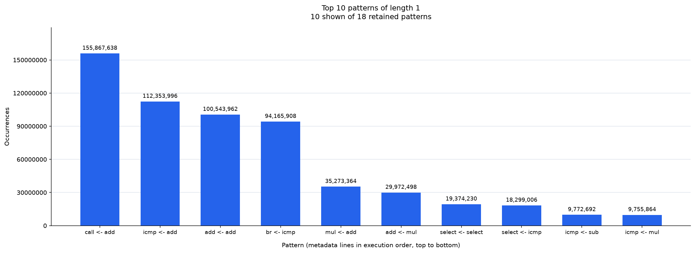
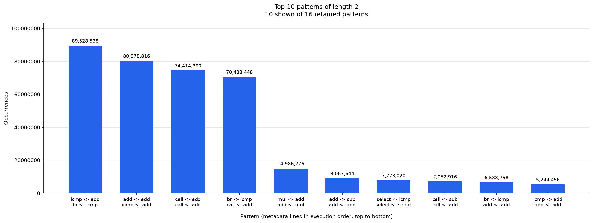
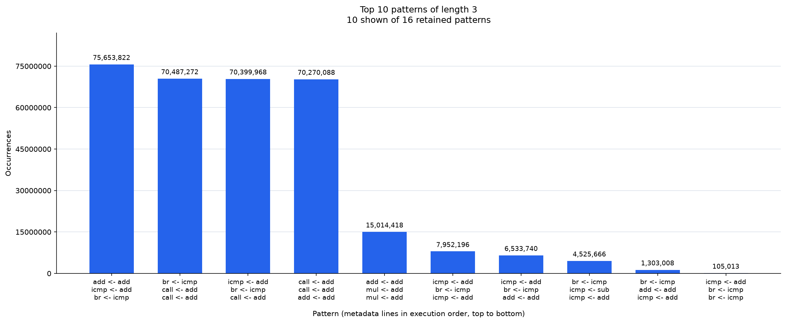
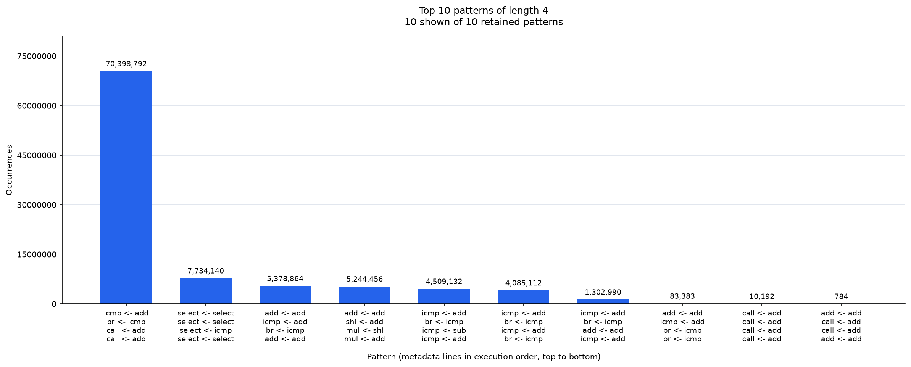
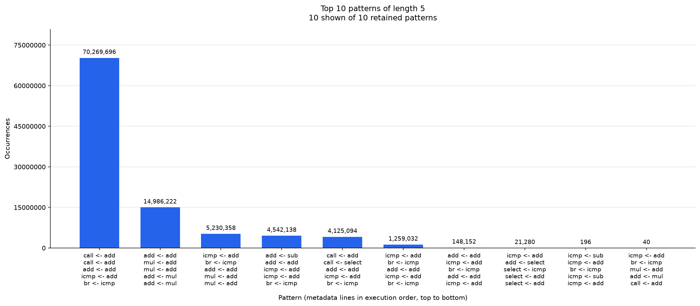

# Trace pass results and script guides

[Project README](../README.md)

The tracing pass records visits to LLVM basic blocks in `app/src/app.c`. The scripts
combine that execution trace with metadata produced during compilation to expand
instruction relationships or count frequent patterns. All commands below run
from the project root.

## Table of contents

- [Results](#results)
  - [Length 1](#length-1)
  - [Length 2](#length-2)
  - [Length 3](#length-3)
  - [Length 4](#length-4)
  - [Length 5](#length-5)
- [Trace and metadata](#trace-and-metadata)
- [Build and capture a trace](#build-and-capture-a-trace)
- [Expand a trace](#expand-a-trace)
- [Collect pattern statistics](#collect-pattern-statistics)
- [Pattern counting and filtering](#pattern-counting-and-filtering)

## Results

The existing results in [stats/](../stats/) describe the earlier pipeline-start
pass, which recorded IR before optimization. Recollect a trace and regenerate
the statistics to replace these charts with results from the optimizer-last
pass; the old trace must not be combined with the new metadata.

To regenerate the displayed results from that capture:

```sh
python3 scripts/trace_stats.py \
  --trace build/trace.txt \
  --bb-metadata build/trace_metadata.txt \
  --output-dir stats \
  --top-k 10
```

Each chart shows the ten most frequent retained patterns at its length. Counts
describe this captured run. Read each column's multiline label from top to
bottom to recover the relationship sequence.

### Length 1



### Length 2



### Length 3



### Length 4



### Length 5



## Trace and metadata

The trace records basic-block visits in execution order. Each call to
`writeBbNumber(size_t)` prints one numeric block ID to standard output. For
example, this trace visits block 0 once and block 1 twice:

```text
0
1
1
```

The pass writes `bb_metadata.txt` during compilation (`build/bb_metadata.txt`
for the CMake build). Each `BB<number>:` section lists the block's instruction
operand relationships as `user_opcode <- operand_opcode`, in instruction and
operand order. For example, `sub <- mul` means a `sub` uses the result of a
`mul`. One instruction can produce several lines; constants and other operands
that are not instructions produce none. A block with no relationships still
has a header.

PHI instructions are skipped as users. When an operand is a PHI result, the
pass emits a relationship for each incoming instruction. If a `sub` uses a
PHI with `mul` and `add` incoming values, its metadata contains:

```text
BB0:
sub <- mul
sub <- add
```

These lines include all incoming instructions, regardless of which predecessor
executes during a particular visit. Metadata is collected before the block's
trace call is inserted. The scripts combine the trace with metadata from the
same build to repeat each visited block's relationships in execution order.

## Build and capture a trace

Enter the Nix shell to get matching Clang and LLVM 21, CMake, Ninja, SDL2, and
Python with Matplotlib, then build the traced executable:

```sh
nix develop
cmake -S . -B build -G Ninja
cmake --build build --target graphical_app_traced
./build/graphical_app_traced > trace.txt
```

Wait for all animation frames to finish, then close the app window to finish
capturing and flush standard output before running either script. Closing it
during the animation triggers an assertion and can leave a truncated trace.
The trace contains only numeric block IDs, for
example:

```text
0
1
1
```

Keep `trace.txt` with the `build/bb_metadata.txt` produced for that executable.
Rebuilding can change block IDs and overwrite metadata, so copy the metadata
alongside a trace before rebuilding if you want to analyze that run later.
The app renders 56 frames and then waits for the window to close; that wait
does not add block visits because `simExit` is not instrumented.

For a build without Nix, see [Build without Nix](../README.md#build-without-nix).
Both scripts require Python 3.9 or newer; only the statistics script needs
Matplotlib. Outside Nix, install it in a virtual environment:

```sh
python3 -m venv .venv
. .venv/bin/activate
python3 -m pip install matplotlib
```

## Expand a trace

[expand_trace.py](../scripts/expand_trace.py) replaces each executed block ID
with that block's metadata lines, preserving visit order:

```sh
python3 scripts/expand_trace.py \
  --trace trace.txt \
  --bb-metadata build/bb_metadata.txt \
  --output trace_expanded.txt
```

| Option | Purpose |
| --- | --- |
| `-t`, `--trace` | Required input file with numeric block IDs. |
| `-m`, `--bb-metadata` | Required metadata file from the same build. |
| `-o`, `--output` | Required output file; must differ from both inputs. |

The output has no `BB<number>:` headers. Repeated visits repeat the block's
lines; blocks with no relationships contribute nothing. For example, with this
metadata and the trace `0`, `1`, `1`:

```text
BB0:
load <- alloca
add <- load
store <- add
store <- alloca
BB1:
icmp <- load
br <- icmp
```

The expanded output is:

```text
load <- alloca
add <- load
store <- add
store <- alloca
icmp <- load
br <- icmp
icmp <- load
br <- icmp
```

Expansion helps inspect the executed relationship stream, but can create a much
larger file than the original trace. The statistics script reads the block trace
directly and does not require this expanded file.

## Collect pattern statistics

[trace_stats.py](../scripts/trace_stats.py) counts patterns of one through five
consecutive metadata lines and writes charts and CSV files:

```sh
python3 scripts/trace_stats.py \
  --trace trace.txt \
  --bb-metadata build/bb_metadata.txt \
  --output-dir trace_stats \
  --top-k 10
```

| Option | Purpose |
| --- | --- |
| `-t`, `--trace` | Required input file with numeric block IDs. |
| `-m`, `--bb-metadata` | Required metadata file from the same build. |
| `-o`, `--output-dir` | Required directory for `csv/` and `images/`; created if needed. |
| `-k`, `--top-k` | Maximum patterns shown per chart; a positive integer, default `10`. |

The output directory contains:

```text
trace_stats/
  csv/patterns_1.csv ... patterns_5.csv
  images/patterns_1.png ... patterns_5.png
```

Each CSV has `pattern,occurrences` columns and includes all retained patterns
of its length. Lines within a pattern are joined with ` | `. Rows are sorted by
decreasing frequency, with alphabetical pattern order for ties. Each PNG shows
up to the requested number of patterns with occurrence counts as column heights.
Changing `--top-k` changes only the charts, not the CSV contents. Charts use
Matplotlib's file-rendering canvas and need no GUI or display server. Running
again in the same output directory overwrites the corresponding CSVs and PNGs.

## Pattern counting and filtering

A pattern is a consecutive sequence of metadata relationships, rather than
a sequence of block IDs. Its length is the number of metadata lines. Patterns
can cross block boundaries and occurrences can overlap. Empty blocks contribute
no lines and do not break a sequence.

The script removes a shorter pattern when a left or right extension has exactly
the same occurrence count. For example, if `add <- load` occurs only as part of
`load <- alloca | add <- load`, and both occur 100 times, the one-line pattern
is omitted. If `add <- load` has another independent occurrence, it is retained.
Filtering uses original counts, so removing an extension does not restore its
shorter patterns. Length-six patterns are counted only to filter length-five
patterns; they are not exported. A length with no retained patterns still gets
a CSV header and a chart with an empty-state message.

To avoid storing the full expanded stream, the script aggregates block visits
and repeated boundary contexts, then weights their windows by visit counts.
Internal windows are processed once per visited block. Boundary contexts are
processed in batches of at most 50,000 distinct contexts. This keeps the counts
exact while bounding the additional boundary-context memory.
